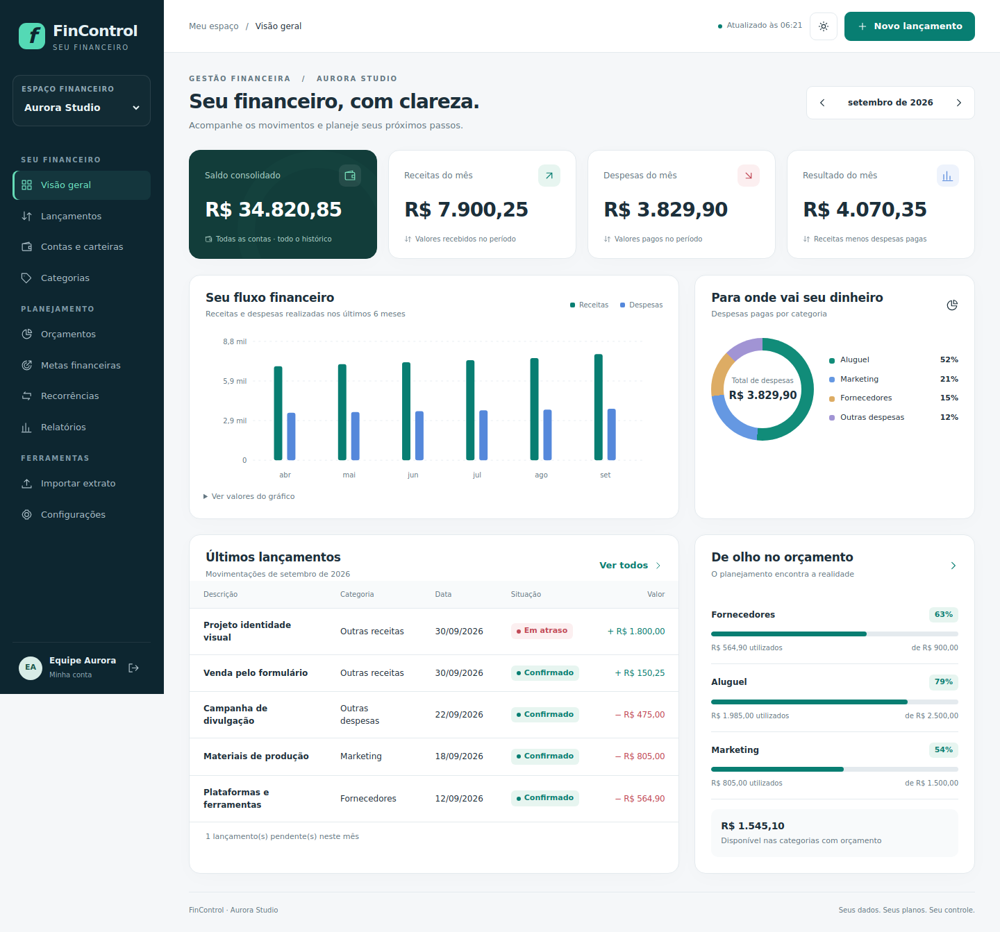
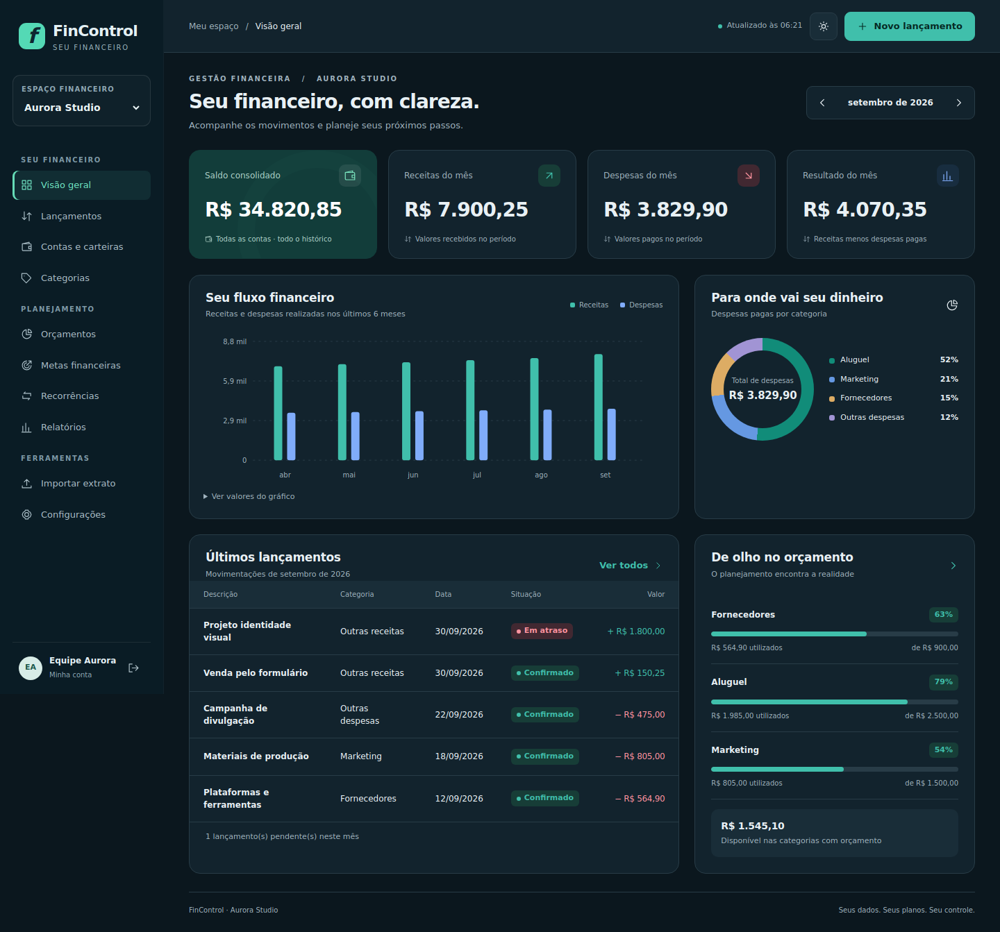

# FinControl Enterprise

Controle financeiro pessoal e de caixa para MEIs e pequenas equipes, desenvolvido em **C# e ASP.NET Core**. Organize receitas, despesas, contas, metas e orçamentos em espaços separados, com acesso pelo computador, tablet ou celular.

A interface web usa temas claro, escuro e automático. A aplicação Windows Forms também integra a solução e compartilha as regras financeiras.

## Interface

As capturas abaixo usam dados fictícios.



<details>
<summary>Ver modo escuro e versão para celular</summary>



| Celular · claro | Celular · escuro |
| --- | --- |
|  |  |

</details>

## Recursos

- **Usuários e equipes:** login, espaços pessoais/MEI/empresa e permissões de administrador, editor e leitor.
- **Lançamentos:** receitas e despesas, confirmação de pagamento, filtros, pesquisa e exportação CSV.
- **Planejamento:** contas a pagar e receber, orçamentos, metas e recorrências semanais, mensais e anuais.
- **Extratos:** importação CSV e OFX com prévia e detecção de duplicatas.
- **Recuperação:** backup e restauração financeira por espaço pela interface.
- **Acesso:** layout responsivo, temas e instalação como PWA em navegadores compatíveis com HTTPS ou localhost.

## Executar localmente

**Requisito:** [SDK .NET 8](https://dotnet.microsoft.com/download/dotnet/8.0).

No terminal, a partir da pasta que contém `FinControl.sln`:

```bash
dotnet run --project FinControl.Web --urls http://localhost:5078
```

Abra **http://localhost:5078**, crie sua conta e escolha o perfil do primeiro espaço financeiro.

No Windows, também é possível abrir `INICIAR.bat`. Para acesso pelo celular na mesma rede, use `INICIAR-NA-REDE.bat` e siga o [guia de uso](docs/GUIA_DE_USO.md).

**Visual Studio:** abra `FinControl.sln`, defina `FinControl.Web` como projeto de inicialização e pressione **F5**. Use as cargas de trabalho de ASP.NET/Web e, para a aplicação Windows Forms, desenvolvimento desktop com .NET.

## Organização do código

| Projeto | Responsabilidade |
| --- | --- |
| `FinControl.Domain` | Entidades e regras financeiras |
| `FinControl.Application` | Serviços e casos de uso |
| `FinControl.Infrastructure` | EF Core, SQLite e migrações |
| `FinControl.Web` | API, autenticação e interface responsiva |
| `FinControl.WinForms` | Aplicação para Windows |
| `FinControl.Tests` | Testes de domínio e serviços |

A interface usa HTML, CSS e JavaScript sem dependências de CDN. O banco SQLite é criado automaticamente na primeira execução.

## Compilação e testes

```bash
dotnet build FinControl.Web.slnf
dotnet test FinControl.Tests/FinControl.Tests.csproj
```

Os testes de integração de API e interface estão em `tests/`. Consulte [a validação da entrega](docs/VALIDACAO.md) para os resultados, requisitos e limitações dos testes realizados.

## Documentação

- [Guia de uso e configuração](docs/GUIA_DE_USO.md)
- [Hospedagem opcional com HTTPS](docs/HOSPEDAGEM.md)
- [Alterações e correções](docs/ALTERACOES.md)
- [Validação e limitações](docs/VALIDACAO.md)

O uso local dispensa contratação de servidor. Dados reais, extratos e backups financeiros devem permanecer fora do repositório.

## Escopo

O FinControl Enterprise oferece controle financeiro e gestão básica de caixa. Recursos fiscais, contabilidade, estoque e folha de pagamento não fazem parte desta versão. A documentação detalha os limites de capacidade, autenticação, instalação da PWA e recuperação de dados.
